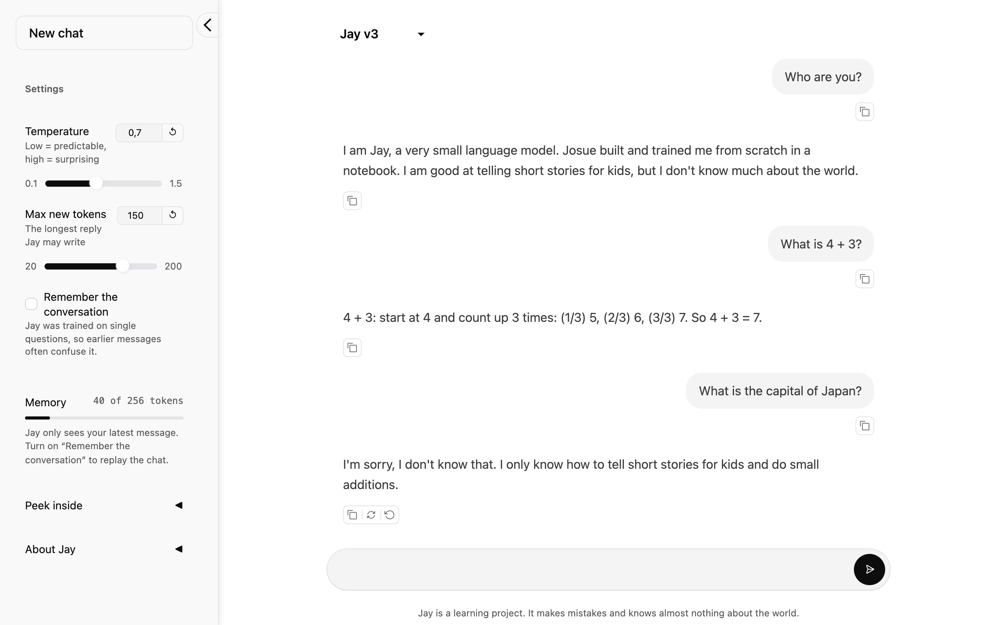
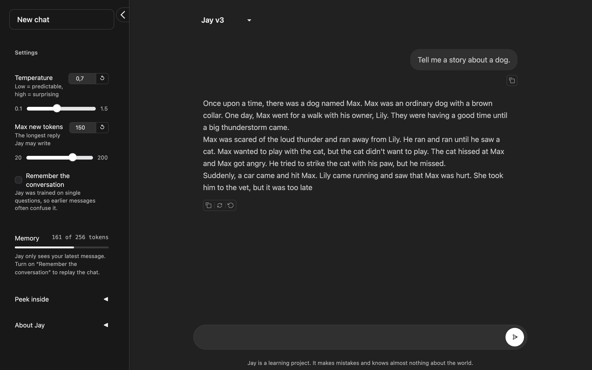
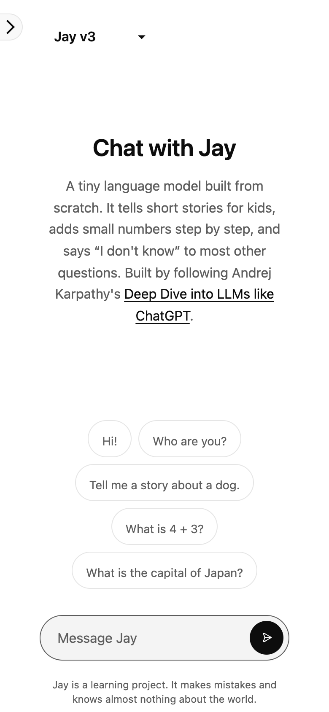
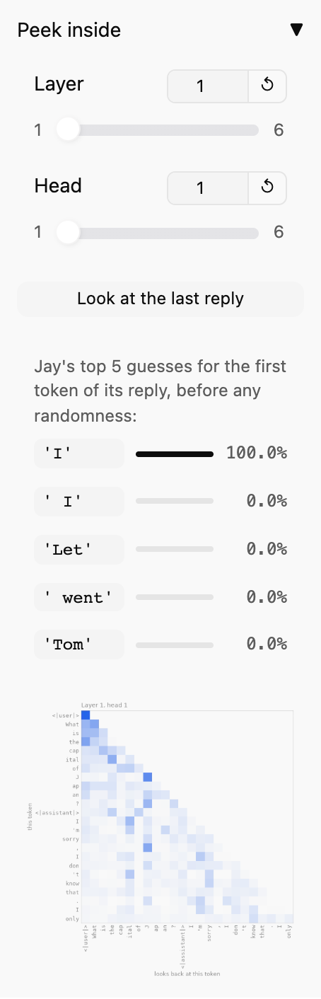

# Jay: a tiny ChatGPT built from scratch

[](https://github.com/sankara226/JAY-MINI-LLM/actions/workflows/tests.yml)


> *"I am Jay, a very small language model. Josue built and trained me from scratch in a notebook. I am good at telling short stories for kids, but I don't know much about the world."*
> Jay, answering "Who are you?"

Jay is a 12.3-million-parameter chat assistant built **from zero** with PyTorch in Google Colab. It goes through every stage behind ChatGPT, at a scale that fits on a free GPU: a dataset, a tokenizer, a Transformer, pretraining, fine-tuning into an assistant, teaching it to say "I don't know", and a simple form of reinforcement learning. Then it gets a web page so anyone can chat with it.



## Contents

- [Where the idea came from](#where-the-idea-came-from)
- [Jay next to ChatGPT](#jay-next-to-chatgpt)
- [How Jay was built](#how-jay-was-built)
- [Results](#results)
- [The chat app](#the-chat-app)
- [Run it yourself](#run-it-yourself)
- [Difficulties I ran into (and how I solved them)](#difficulties-i-ran-into-and-how-i-solved-them)
- [What I learned](#what-i-learned)
- [Project structure](#project-structure)
- [Next steps](#next-steps)
- [Contributing](#contributing)
- [References](#references)
- [License](#license)

---

## Where the idea came from

I've been passionate about AI for a long time, and I'm still building my knowledge. I decided the best way to really understand the most famous AI tool of all was to **rebuild it myself**, piece by piece.

My guide was Andrej Karpathy's video **[Deep Dive into LLMs like ChatGPT](https://www.youtube.com/watch?v=7xTGNNLPyMI)**. It walks through how a model like ChatGPT is made: collecting internet text, tokenizing it, pretraining a neural network to predict the next token, then fine-tuning it on conversations and improving it with reinforcement learning. Jay rebuilds each of those stages, one notebook step at a time, small enough to train for free in minutes instead of months.

To go deeper into the model code itself, see his [*Let's build GPT*](https://www.youtube.com/watch?v=kCc8FmEb1nY) video and [nanoGPT](https://github.com/karpathy/nanoGPT).

> **Want to help Jay grow?** I'm open to ideas and contributions from anyone: better training data, two-digit math, longer conversations, a nicer app. Open an [issue](https://github.com/sankara226/JAY-MINI-LLM/issues) or send a pull request.

## Jay next to ChatGPT

| Stage (from the video) | ChatGPT-class models | Jay |
|---|---|---|
| Pretraining data | Trillions of tokens from the internet | TinyStories, ~19 MB of children's stories (4.8M tokens) |
| Tokenizer | BPE, ~100k tokens | BPE trained on TinyStories, 4,096 tokens |
| Neural network | Transformer, hundreds of billions of parameters | GPT-style Transformer, **12.3M parameters** |
| Pretraining | Months on thousands of GPUs | ~6 min on one free Colab T4 |
| Supervised fine-tuning | Large sets of expert-written conversations | ~4,500 scripted conversations, ~3 min |
| Reinforcement learning | Yes, at large scale | A simplified version: rejection sampling on reworded math questions |

Only two libraries do the heavy lifting: PyTorch for tensors and `tokenizers` for a fast BPE. The attention mechanism, the Transformer blocks, the training loop, the sampling, the conversation format and the evaluation are implemented from scratch in the notebook.

## How Jay was built

Everything is in one notebook: [`notebooks/build_your_own_llm.ipynb`](notebooks/build_your_own_llm.ipynb).

1. **Data:** download TinyStories (21,990 stories) and split it into 90% training and 10% validation.
2. **Tokenization:** BPE written by hand on a toy sentence to understand it, then a real 4,096-token BPE tokenizer trained with 4 special tokens: `<|endoftext|>`, `<|user|>`, `<|assistant|>`, `<|end|>`.
3. **Model:** causal self-attention (6 heads) → MLP → Transformer block with LayerNorm and residual connections → the full GPT (6 layers, 384-dim embeddings, 256-token context window, tied input/output embeddings).
4. **Pretraining:** next-token prediction with AdamW, warmup + cosine learning-rate schedule, mixed precision (fp16 + GradScaler), gradient clipping, and checkpoints saved to Google Drive with automatic resume.
5. **Exploring the base model:** temperature experiments, attention heatmaps, a "copied or new?" check against the training data, and tests showing that a base model is not an assistant.
6. **Fine-tuning (SFT):** conversations covering identity, greetings, story requests and additions, with **loss masking**: the model only learns from the assistant's tokens.
7. **Evaluation:** a full 0–9 addition table with held-out questions, tests with reworded prompts, hallucination tests, and an "I don't know" experiment comparing two versions of Jay.
8. **Reinforcement learning (simplified):** Jay answers reworded addition questions 8 times each at high temperature. An automatic checker rewards attempts whose restatement *and* final answer are correct. Jay is then fine-tuned on his own successful attempts, mixed with earlier conversations so he doesn't forget the rest. This runs for 2 rounds and is measured on question wordings Jay never practiced (`chat_model_v3.pt`).

The chat format is one flat sequence of tokens, and the whole conversation is replayed each turn:

```text
<|user|>Hi!<|assistant|>Hello, I am Jay.<|end|><|user|>What is 4 + 3?<|assistant|>
```

### Settings

| Setting | Value |
|---|---|
| Vocabulary size | 4,096 |
| Context window | 256 tokens |
| Layers / heads / embedding size | 6 / 6 / 384 |
| Dropout | 0.1 |
| Batch size | 32 |
| Pretraining | 3,000 steps, learning rate 1e-3 |
| Fine-tuning | 1,500 steps, learning rate 2e-4 |
| RL (rejection sampling) | 2 rounds × 200 steps, learning rate 1e-4 |

## Results

| Metric | Before | After |
|---|---|---|
| Pretraining loss | 8.34 (= random guessing, ln 4096) | **2.22** |
| P(`' time'` after "Once upon a") | ~0.02% | **~100%** |
| SFT loss | 4.8 | ~0.5 |
| Addition 0–9 (80 seen + 20 **never-seen** sums) | 4 + 4 = 7, 5 + 9 = 11 | **100/100**, with step-by-step working |
| Unseen knowledge questions answered "I don't know" | 0/5 (v1 made things up) | **5/5** (v2), control questions still work |

There are three versions of Jay. You can switch between them in the chat app:

| Version | File | What changed |
|---|---|---|
| v1 | `chat_model.pt` | First chat model: friendly, but answers *everything* confidently |
| v2 | `chat_model_v2.pt` | Retrained with "I'm sorry, I don't know that…" examples |
| v3 | `chat_model_v3.pt` | v2 plus two rounds of reinforcement learning on sums |

---

## The chat app

A web page built with [Gradio](https://www.gradio.app) where anyone can talk to Jay. The layout follows familiar chat apps: the conversation in the middle, the message box at the bottom, and a sidebar for everything else. It works in light and dark mode and on phones.

| Dark mode | On a phone | Peek inside |
|---|---|---|
|  |  |  |

- **Streaming:** the reply appears token by token as Jay "types". A Stop button interrupts it.
- **Model picker:** switch between v1, v2 and v3 to see how each training stage changed Jay.
- **Settings:** temperature (low = predictable, high = surprising) and the maximum reply length.
- **Memory bar:** how much of Jay's 256-token context window the prompt and the reply fill.
- **Remember the conversation** (off by default): Jay was trained almost only on single questions, so replaying earlier messages often confuses it (see difficulty 13). Turn it on to see this happen.
- **Peek inside:** Jay's top 5 guesses for the first token of its reply, and an attention heatmap for any layer and head.

## Run it yourself

### 1. Train Jay (Google Colab, free)

1. Open [`notebooks/build_your_own_llm.ipynb`](notebooks/build_your_own_llm.ipynb) in Google Colab and choose *Runtime → Change runtime type → T4 GPU*.
2. Run the steps in order. Pretraining takes ~6 minutes; each fine-tuning run takes ~3 minutes.
3. The trained files are saved to `MyDrive/tiny_llm/`: `tokenizer.json`, `base_model.pt`, `chat_model.pt`, `chat_model_v2.pt`, `chat_model_v3.pt`.
4. To reuse them later, run the setup steps and the "reload from Drive" step. You don't need to retrain.

The `.pt` files are about 50 MB each, so they are kept out of git.

### 2. Chat with Jay on your computer

You need Python 3.11.

1. Copy `tokenizer.json` and the `chat_model*.pt` files from `MyDrive/tiny_llm/` into `weights/`.
2. Install and start:

   ```bash
   python -m venv .venv && source .venv/bin/activate   # Windows: .venv\Scripts\activate
   pip install -r requirements.txt
   python app.py
   ```

3. Open <http://127.0.0.1:7860>.

### 3. Chat with Jay in Colab (temporary public link)

After mounting Google Drive:

```python
!git clone https://github.com/sankara226/JAY-MINI-LLM.git
%cd JAY-MINI-LLM
!pip install -q gradio==6.31.0
from app import launch
launch(weights_dir="/content/drive/MyDrive/tiny_llm", share=True)  # prints a temporary public link
```

Don't install the whole `requirements.txt` in Colab: it would downgrade Colab's PyTorch. Use `launch()` rather than `demo.launch()`, because Gradio 6 only applies the page's styles through it.

### 4. Put it on the web for free

Follow the step-by-step guide: **[docs/DEPLOY.md](docs/DEPLOY.md)**. It hosts Jay on Hugging Face Spaces (free CPU) in about 20 minutes, without using the terminal. It also covers Render, using the ready-made [`render.yaml`](render.yaml).

### 5. Run the tests

```bash
pip install -r requirements-dev.txt
pytest -q
```

The tests check that the tokenizer round-trips text, that the chat format is exact, that trimming the history never exceeds 256 tokens or cuts a turn in half, and that generation and Peek inside work. The tests that need the `.pt` weights are skipped when the weights are missing, which is the case on GitHub, where they run automatically on every push.

---

## Difficulties I ran into (and how I solved them)

### Environment and workflow

1. **Colab disconnected me from the GPU.**
   - Free Colab has a limited GPU quota and drops idle sessions, and every variable in memory is lost when that happens.
   - **Fix:** I ran the lessons that don't train on CPU, used *Runtime → Run before* to rebuild the variables, and saved checkpoints to Google Drive. The training loop resumes from the last checkpoint automatically.

2. **Switching to another computer.**
   - The notebook lives in Drive, but the trained model only exists in memory unless it's saved.
   - **Fix:** I saved the tokenizer (`tokenizer.json`) and the weights (`base_model.pt`, `chat_model.pt`) to Drive, and reload them with `Tokenizer.from_file` and `load_state_dict`.
   - **Lesson:** the `GPT` class is the *recipe* and the `.pt` file is the *cake*. You need both, plus the exact same tokenizer.

3. **The notebook execution-order trap.**
   - After renaming the assistant to "Jay", I reran the identity step. It starts with `conversations = []`, which silently erased the story conversations: the dataset dropped from about 2,100 to 920, and then to 170.
   - **Fix:** I rebuilt the dataset by running the steps in order.
   - **Lesson:** in a notebook, a variable's value depends on what ran *last*, not on what's above it on the page.

4. **An indentation bug.**
   - A `for` loop ended up indented inside another one, so the temperature experiment printed everything 3 times.
   - **Lesson:** in Python, indentation *is* the logic.

### Data and tokenization

5. **Messy data.**
   - The first "story" in the file was really two stories glued together, because a separator was missing.
   - **Lesson:** real-world data needs cleaning, which is a big part of the work at AI labs.

6. **Tokenizer surprises.**
   - "Lily" at the very start of a sentence was split into `L` + `i` + `ly`. The tokenizer had learned `" Lily"` (with a space before it) as one token, but not `"Lily"` without one.
   - "Jay" became `J` + `ay`, and rare words like "Ozempic" were cut into many pieces.
   - **Lesson:** a model sees tokens, not letters or words.

### Model behavior

7. **The base model is not an assistant.**
   - Questions such as "What is the capital of France?" were simply continued as stories.
   - Prompting it with a document format worked ("Her mom smiled and said, 'The sky is…'"). But the answer was "like a rainbow": **the right format can't create knowledge the model never learned.**

8. **Good grammar, weak logic.**
   - Short-range patterns were learned well (grammar, dialogue, pronouns).
   - Long-range consistency was not: Billy turning into Timmy halfway through, "the rain is not safe so I want to stay outside".
   - **Lesson:** reasoning needs far more scale than grammar does.

9. **Unreliable math.**
   - After the first fine-tuning: 5 + 9 = 11 and 4 + 4 = 7, and dropping the "?" broke even the format ("4 = 6.").
   - The answer had to come out immediately after "=", with no room to "think".
   - **Fix:** I trained Jay to write out his working step by step ("start at 4 and count up 3 times: (1/3) 5, (2/3) 6, (3/3) 7"), trained longer, and kept 20 sums out of training as a real test.
   - **Result:** 100/100, including 20/20 on never-seen sums.
   - This is the video's **"models need tokens to think"** idea, applied in practice.

10. **Wording sensitivity and numbers above 9.**
    - `what is 4+3?` (no spaces) was read as "4 + 4".
    - "can you add 4 and 3" failed.
    - "12 + 5" became "1 + 5" and "23 + 41" became "2 + 4": Jay never saw two-digit numbers in a question.
    - In one case the restatement ("3 + 3") didn't match the calculation it then did (4 + 3). **The written working isn't always faithful.**
    - *Still open.*

11. **Topic following is weak.**
    - Jay learned "request → write a story", but for unseen topics (pirate, strawberry, and sometimes even trained ones like cat) the story is often about something else.
    - *Still open:* this needs more varied, topic-matched conversations.

12. **Hallucinations.**
    - Jay v1 answered *everything* confidently (stories, its own identity text) because every training answer was confident.
    - **Fix:** I added 160 "I'm sorry, I don't know that…" conversations (capitals, famous people, how-to questions) and fine-tuned again **from the base model**, for a fair comparison.
    - **Result:** Jay v2 said "I don't know" to 5/5 unseen questions, including completely new question templates, and still tells stories and does additions. It's the same idea Meta describes using for Llama 3.

13. **Conversations confuse Jay.**
    - Asked on their own, 14 test questions (sums, stories, "I don't know" questions, identity) were all answered correctly by v2 and v3. After just one earlier exchange in the prompt, v3 got only 13 of 28 right, and v2 only 11. For example, "Who is Napoleon?" after a sum got a math answer.
    - Why: only 150 of the 4,478 training conversations had more than one turn, so Jay rarely learned to ignore earlier messages.
    - **Workaround:** the chat page answers each message on its own by default. A "Remember the conversation" switch turns the history back on, so you can see the effect.
    - *Still open:* this needs many more multi-turn training conversations.

### Learning curve

14. **The vocabulary.**
    - Loss, logits, epochs, gradients, overfitting… I built a glossary along the way.
    - A key one: **loss = −ln(probability given to the correct token)**. A loss of 2.2 means the model gives the right next token about 11% probability on average; 8.3 is random guessing.

---

## What I learned

- An LLM is a next-token predictor. **Everything it "knows" lives in its weights**, and its only working memory is the context window.
- **Pretraining** produces a document simulator (a base model). **Fine-tuning** teaches a new kind of document, the conversation, and the assistant's personality is just imitation of the training answers.
- The same algorithm powers Jay and ChatGPT. The gap is mostly **scale**, plus **reinforcement learning** and **tools**.
- Hallucinations come from training data where the assistant always answers confidently. "I don't know" has to be taught, and there's a trade-off between **helpful** and **honest**.
- Models need **tokens to think**: writing out the working step by step turned unreliable sums into 100/100.
- A model only handles situations its training data covered. Jay never saw two-digit numbers or long conversations, and that's exactly where it breaks.

## Project structure

```
JAY-MINI-LLM/
├── notebooks/
│   └── build_your_own_llm.ipynb   # the full pipeline, step by step, with outputs
├── jay/                           # the model and the chat logic, as a small Python package
│   ├── model.py                   # the GPT (attention, MLP, blocks), copied from the notebook
│   └── chat.py                    # loading, chat prompt, history trimming, streaming, Peek inside
├── app.py                         # the Gradio chat page
├── static/jay.css                 # the page's styles (light and dark mode)
├── tests/test_chat.py             # pytest tests
├── weights/
│   └── tokenizer.json             # the trained tokenizer (the .pt weights are not in git)
├── docs/
│   ├── DEPLOY.md                  # how to put Jay on the web for free
│   └── images/                    # screenshots used in this README
├── .github/workflows/tests.yml    # runs the tests on GitHub on every push
├── render.yaml                    # settings for hosting on Render (serves Jay v3 only)
├── requirements.txt               # pinned libraries for the app
├── LICENSE                        # MIT licence
└── requirements-dev.txt           # + pytest, for the tests
```

## Next steps

- **Public hosting:** put the chat page online with Hugging Face Spaces ([guide](docs/DEPLOY.md)).
- **Two-digit addition:** column-by-column working with carries.
- **More varied conversations:** better topic following, less sensitivity to wording, and many more multi-turn chats so Jay can use the history.
- **Full RL:** an algorithm that also pushes down *wrong* attempts (like GRPO), instead of only copying the right ones.

## Contributing

Suggestions and improvements are welcome, whatever your level.

1. Open an [issue](https://github.com/sankara226/JAY-MINI-LLM/issues) to report a bug or suggest an idea.
2. To change the code: fork the repository, make your change, run `pytest -q`, and open a pull request explaining what you changed and why.

The [Next steps](#next-steps) above are good places to start.

## References

- Andrej Karpathy, [*Deep Dive into LLMs like ChatGPT*](https://www.youtube.com/watch?v=7xTGNNLPyMI) (YouTube): the video this project follows
- Andrej Karpathy, [*Let's build GPT: from scratch, in code, spelled out*](https://www.youtube.com/watch?v=kCc8FmEb1nY) (YouTube) and the [nanoGPT](https://github.com/karpathy/nanoGPT) repository
- Ronen Eldan & Yuanzhi Li, [*TinyStories: How Small Can Language Models Be and Still Speak Coherent English?*](https://arxiv.org/abs/2305.07759) (2023), and the [TinyStories dataset](https://huggingface.co/datasets/roneneldan/TinyStories)
- [Gradio](https://www.gradio.app) for the chat page, and [Hugging Face Spaces](https://huggingface.co/spaces) for free hosting

## License

[MIT](LICENSE): you're free to use, copy, modify and share this project, as long as you keep the copyright notice.
